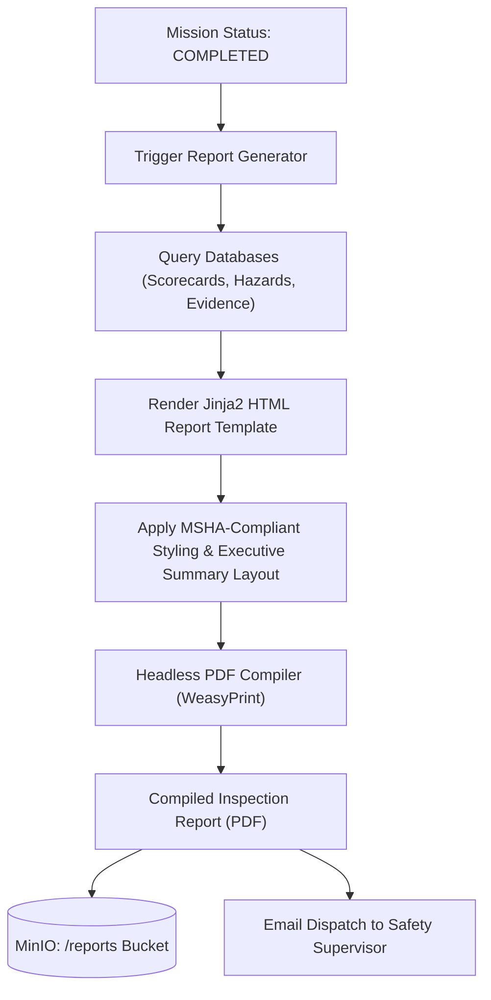

# Submodule 3.5.4: Report Generation

## 1. Purpose
Generates automated, professional, audit-ready PDF and interactive HTML inspection reports summarizing mission findings, asset scorecards, thermal anomalies, and hazard logs.

## 2. Responsibility
Collate mission metadata, asset grades, thermal and visual evidence, and maps; compile professional documents conforming to mining regulatory standards (MSHA / ISO).

## 3. Scope
### In-Scope
Report template design (HTML/CSS), automated headless PDF compilation (WeasyPrint / Puppeteer), executive summary generation, and export APIs.

### Out-of-Scope
Legal liability sign-off.

## 4. System Architecture

## 5. Internal Submodules
- **Jinja2 Report Templater**: Binds dynamic mission metrics, asset photos, thermal maps, and anomaly tables into semantic HTML.
- **PDF Rendering Engine**: Compiles HTML/CSS into print-ready PDF documents with pagination, headers, and footers.

## 6. Functional Requirements
- **REQ-3.5-007**: Report generator shall produce complete inspection reports in both PDF and interactive HTML formats.
- **REQ-3.5-008**: PDF generation for a 50-asset inspection mission shall execute in `[PROPOSED TARGET: < 15.0 s]`.

## 7. Technical Approach
Deploy Python microservice using Jinja2 templates and WeasyPrint. Incorporate embedded high-resolution inspection photos, false-color thermal images, and executive summaries.

## 8. Open-Source Resources
### WeasyPrint
- **What it provides**: Visual rendering engine transforming HTML/CSS to PDF.
- **Why it is relevant**: Produces beautiful, paged, standards-compliant PDF reports.
- **What we can reuse**: WeasyPrint compiler.
- **What we must develop ourselves**: Mining compliance report templates.

## 9. Prerequisites
Submodule 3.5.1, Submodule 3.5.2, Submodule 3.5.3, WeasyPrint.

## 10. Dependencies
- **Upstream Dependencies**: Submodule 3.3.5 Inspection Results, Submodule 3.5.2 Inspection Database.
- **Downstream Dependencies**: None (Terminal reporting artifact).
- **Interfaces with Other Modules**: REST endpoint `/api/v1/reports/generate/{mission_id}`.

## 11. Development Phases
### Phase 1: Report Template & Compiler
- **Objective**: Build Jinja2 template and PDF generation pipeline.
- **Activities**: Design HTML layout, integrate WeasyPrint, test compilation.
- **Required resources**: Python, Jinja2, WeasyPrint.
- **Input**: Mission results JSON.
- **Output**: InspectionReport.pdf.
- **Dependencies**: None.
- **Validation**: Compile report for simulated mission; check pagination and image clarity.
- **Completion criteria**: PDF generates cleanly with zero layout overflow.

## 12. Interfaces
### Templates
- `templates/reports/inspection_report_template.html`: MSHA-compliant HTML/CSS report template.

## 13. Testing Strategy
Generate report for mission with 3 FAIL assets; verify failure cards are prominently highlighted in red on page 1 with temperature anomalies listed.

## 14. Known Challenges
- **Image Layout Overflow**: Large image tables can cause awkward page breaks in PDFs; requires CSS paged media rules (`page-break-inside: avoid`).

## 15. Implementation Status
`PLANNED`

## 16. References
- [WeasyPrint Documentation](https://weasyprint.org)
