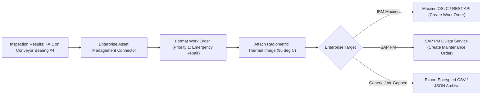

# Submodule 3.6.4: Enterprise Asset Management Integration

## 1. Purpose
Connects the inspection platform to enterprise asset management (EAM) and maintenance software systems, specifically IBM Maximo and SAP Plant Maintenance (PM).

## 2. Responsibility
Synchronize asset catalogs from enterprise ERP, export inspection findings, and automatically trigger maintenance corrective work orders when inspection criteria FAIL.

## 3. Scope
### In-Scope
IBM Maximo REST/OSLC connector, SAP PM RFC/OData connector, automated work order generation, and standard CSV/JSON export.

### Out-of-Scope
Enterprise billing and payroll accounting.

## 4. System Architecture

## 5. Internal Submodules
- **IBM Maximo OSLC Connector**: Integrates with IBM Maximo REST API for automated asset querying and work order creation.
- **SAP PM OData Connector**: Integrates with SAP S/4HANA Plant Maintenance module for industrial maintenance notification generation.

## 6. Functional Requirements
- **REQ-3.6-007**: A failed inspection result shall automatically generate a maintenance work order in the connected EAM within 5.0 seconds.
- **REQ-3.6-008**: Work orders shall include direct hyperlinks and base64 attachments of the qualifying thermal evidence.

## 7. Technical Approach
Implement a modular integration service in Python. Utilize standard OSLC (Open Services for Lifecycle Collaboration) for Maximo and OData v4 for SAP PM. Fall back cleanly to signed CSV export if enterprise network is disconnected.

## 8. Open-Source Resources
### OData / OSLC Standard Libraries
- **What it provides**: Standardized industrial enterprise communication protocols.
- **Why it is relevant**: Standard protocols used by Maximo and SAP.
- **What we can reuse**: Python requests / OData client.
- **What we must develop ourselves**: Mining work order mapping template.

## 9. Prerequisites
Submodule 3.3.5 Inspection Results.

## 10. Dependencies
- **Upstream Dependencies**: Submodule 3.3.5 Inspection Results.
- **Downstream Dependencies**: None.
- **Interfaces with Other Modules**: REST outgoing requests to Maximo/SAP.

## 11. Development Phases
### Phase 1: EAM Connector Service
- **Objective**: Implement Maximo work order dispatcher and CSV exporter.
- **Activities**: Code integration worker, test with mock Maximo REST server.
- **Required resources**: Python, requests.
- **Input**: Failed inspection scorecard.
- **Output**: Created work order ID.
- **Dependencies**: None.
- **Validation**: Feed FAIL inspection; verify mock Maximo creates work order #WO-10492.
- **Completion criteria**: Work order created with attached thermal evidence link.

## 12. Interfaces
### Config
- `config/integrations/eam_config.yaml`: Connection endpoints and authentication for Maximo and SAP.

## 13. Testing Strategy
Trigger simulated critical thermal failure; verify EAM bridge automatically generates work order with correct asset tag and attached thermal image.

## 14. Known Challenges
- **Air-Gapped Mine Operations**: Remote underground mines often operate disconnected from corporate corporate SAP networks for days; requires queueing work orders locally until satellite/fiber uplink is restored.

## 15. Implementation Status
`PLANNED`

## 16. References
- [IBM Maximo REST API Guide](https://www.ibm.com/docs/en/maximo-manage/)
- [SAP Plant Maintenance (PM) Overview](https://help.sap.com)
