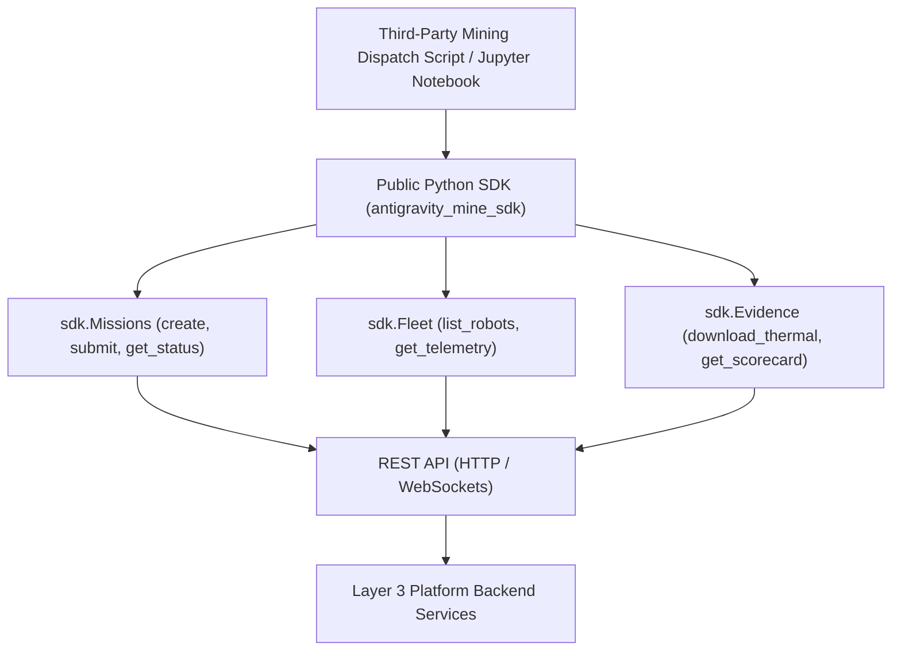

# Submodule 3.6.1: Public SDK

## 1. Purpose
Provides an intuitive, strongly typed Python and C++ client SDK allowing third-party developers and researchers to programmatically interact with the multi-robot platform.

## 2. Responsibility
Expose ergonomic client APIs for mission creation, task dispatching, telemetry streaming, inspection evidence download, and event subscription.

## 3. Scope
### In-Scope
Python client package (`antigravity-mine-sdk`), C++ client headers, type hints, async/await bindings, and API documentation.

### Out-of-Scope
Internal low-level ROS 2 controller handles.

## 4. System Architecture

## 5. Internal Submodules
- **Python Client Library**: Type-annotated Python library utilizing `httpx` and `websockets` for asynchronous API consumption.
- **SDK Example Suite**: Curated Jupyter notebooks demonstrating mission authoring, automated dispatching, and evidence analysis.

## 6. Functional Requirements
- **REQ-3.6-001**: Public SDK shall provide 100% type coverage with complete mypy / type-hint validation.
- **REQ-3.6-002**: SDK operations shall support both synchronous and asynchronous (`asyncio`) execution paradigms.

## 7. Technical Approach
Generate Python client code from OpenAPI 3.0 specifications using `openapi-python-client` or write a clean wrapper over `httpx`. Publish package to local/internal PyPI repository.

## 8. Open-Source Resources
### HTTPX (Python)
- **What it provides**: Next-generation HTTP client with async support.
- **Why it is relevant**: Provides robust networking for the Python SDK.
- **What we can reuse**: AsyncClient library.
- **What we must develop ourselves**: Robotics mission client wrapper.

## 9. Prerequisites
Python 3.10+, Submodule 3.6.2 Mission APIs.

## 10. Dependencies
- **Upstream Dependencies**: Submodule 3.6.2 Mission APIs.
- **Downstream Dependencies**: None.
- **Interfaces with Other Modules**: REST API `/api/v1/...`.

## 11. Development Phases
### Phase 1: SDK Package Implementation
- **Objective**: Implement Python SDK and publish wheel.
- **Activities**: Code client classes, write unit tests with mock server, publish wheel.
- **Required resources**: Python, httpx, poetry.
- **Input**: OpenAPI spec.
- **Output**: antigravity_mine_sdk wheel.
- **Dependencies**: None.
- **Validation**: Install wheel; execute test script submitting mock mission.
- **Completion criteria**: Mission submitted and status polled via 5 lines of Python.

## 12. Interfaces
### Python
- `from antigravity_mine_sdk import MineInspectionClient`: Primary SDK client import.

## 13. Testing Strategy
Run automated SDK integration test suite against live test server; test mission creation, status polling, and evidence retrieval.

## 14. Known Challenges
- **Breaking Changes Across API Versions**: Evolving platform REST APIs can break existing SDK client scripts; requires strict semantic versioning and backward compatibility tests.

## 15. Implementation Status
`PLANNED`

## 16. References
- [HTTPX Documentation](https://www.python-httpx.org)
