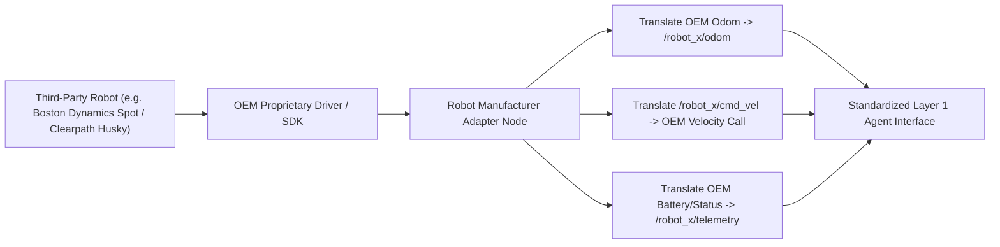

# Submodule 3.6.3: Robot Manufacturer Adapters

## 1. Purpose
Provides a modular Hardware Abstraction Layer (HAL) adapter framework for integrating third-party commercial OEM robots (e.g., Boston Dynamics Spot, Clearpath Husky) into the platform.

## 2. Responsibility
Translate proprietary OEM robot telemetry, motion commands, and payload triggers into standardized Layer 1 Robot Agent ROS 2 interfaces.

## 3. Scope
### In-Scope
OEM adapter plugin interface, telemetry translation, velocity command mapping, battery status conversion, and payload action wrapping.

### Out-of-Scope
Reverse-engineering proprietary OEM closed-source motor firmware.

## 4. System Architecture

## 5. Internal Submodules
- **Base Adapter Interface (C++)**: Abstract base class defining required hardware conversion methods (`send_velocity`, `read_odometry`, `read_battery`).
- **Clearpath / Spot Reference Adapters**: Reference implementations bridging popular commercial inspection robots.

## 6. Functional Requirements
- **REQ-3.6-005**: Integrating a third-party robot shall require implementing the adapter interface without modifying Layer 2 autonomy logic.
- **REQ-3.6-006**: Adapter translation latency between ROS 2 `/cmd_vel` and OEM driver shall remain < 5 ms.

## 7. Technical Approach
Define a C++ plugin interface using `pluginlib`. Third-party manufacturers implement a shared library plugin inheriting from `RobotManufacturerAdapterBase` that wraps their proprietary C++/Python SDK.

## 8. Open-Source Resources
### pluginlib (ROS 2)
- **What it provides**: Plugin loading architecture for ROS packages.
- **Why it is relevant**: Enables dynamically loading OEM adapters at runtime without recompilation.
- **What we can reuse**: ClassLoader templates.
- **What we must develop ourselves**: Robot adapter plugin interface.

## 9. Prerequisites
Submodule 1.5.4 Task Execution Interface, `pluginlib`.

## 10. Dependencies
- **Upstream Dependencies**: Submodule 1.5.4 Task Execution Interface.
- **Downstream Dependencies**: None.
- **Interfaces with Other Modules**: C++ abstract class `RobotManufacturerAdapterBase`.

## 11. Development Phases
### Phase 1: Adapter Plugin Framework
- **Objective**: Define pluginlib interface and build mock third-party adapter.
- **Activities**: Write base class, implement mock adapter, test dynamic loading.
- **Required resources**: C++, pluginlib.
- **Input**: Adapter specs.
- **Output**: libMockRobotAdapter.so.
- **Dependencies**: None.
- **Validation**: Load mock adapter via launch parameter; verify standard ROS 2 topics published.
- **Completion criteria**: Third-party robot publishes standard telemetry.

## 12. Interfaces
### Headers
- `interfaces/robot_adapter_base.hpp`: C++ abstract base class for manufacturer adapters.

## 13. Testing Strategy
Launch simulation with Robot A, Robot B, and a third mock robot loaded via the adapter; verify all 3 robots participate in task allocation seamlessly.

## 14. Known Challenges
- **Proprietary Safety Black Boxes**: Some commercial robots have internal non-configurable collision avoidance that may fight Nav2 local planning; requires tuning Nav2 costmap inflations to match OEM tolerances.

## 15. Implementation Status
`PLANNED`

## 16. References
- [ROS 2 pluginlib Documentation](https://docs.ros.org/en/humble/Tutorials/Beginner-Client-Libraries/Pluginlib.html)
