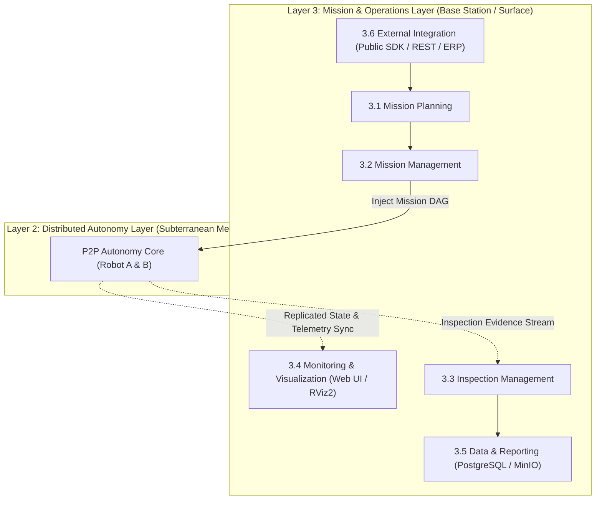

# Layer 3: Mission and Operations Layer

## 1. Overview
The **Mission and Operations Layer** provides human operators and enterprise systems with comprehensive tools for declarative mission planning, operational telemetry monitoring, inspection evidence cataloging (visual and radiometric thermal), automated compliance reporting, and external enterprise API integrations.

---

## 2. Architectural Role
Layer 3 interfaces with **Layer 2 (Distributed Autonomy Layer)** via asynchronous mission ingestion and state synchronization. It does **not** serve as a central controller during mission execution; if the communication link between Layer 3 and the multi-robot fleet is broken, the robots continue autonomous exploration and inspection uninterrupted.

---

## 3. Module Index

| Module | Description | Directory Link |
|---|---|---|
| **3.1 Mission Planning** | Mission creation wizard, inspection objectives, DAG validation | [3.1 Mission Planning](3.1_mission_planning/README.md) |
| **3.2 Mission Management** | Mission submission, live progress tracking, audit history | [3.2 Mission Management](3.2_mission_management/README.md) |
| **3.3 Inspection Management** | Inspection points, visual and radiometric thermal evidence | [3.3 Inspection Management](3.3_inspection_management/README.md) |
| **3.4 Monitoring & Visualization** | Mine 2D/3D maps, robot trails, auction views, link status | [3.4 Monitoring & Visualization](3.4_monitoring_visualization/README.md) |
| **3.5 Data & Reporting** | Relational database schema, object storage, PDF reports | [3.5 Data & Reporting](3.5_data_reporting/README.md) |
| **3.6 External Integration** | Python Public SDK, REST API, ERP/Maximo/SAP connectors | [3.6 External Integration](3.6_external_integration/README.md) |
