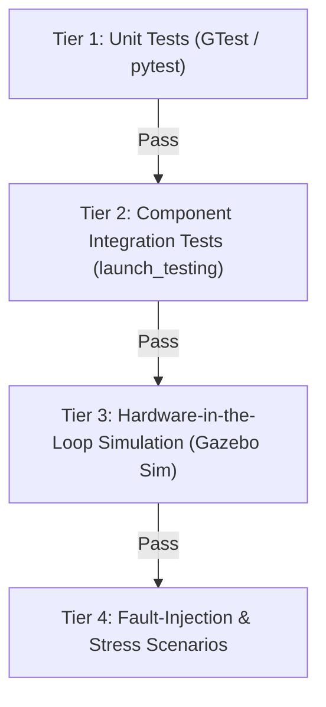

# Multi-Tier Test Strategy

## 1. Testing Philosophy
In subterranean multi-robot systems, physical testing is expensive, dangerous, and difficult to instrument. The testing strategy mandates:
1. **Aggressive Unit Testing**: Pure functions (CRDT merges, cost functions, DAG validators) are validated with exhaustive property-based unit tests.
2. **Deterministic Middleware Testing**: Networking logic is validated with synthetic network traffic shapers (`netem` / Zenoh router filters).
3. **Continuous Simulation Verification**: Every release milestone is benchmarked inside the Gazebo Sim subterranean mine world.

