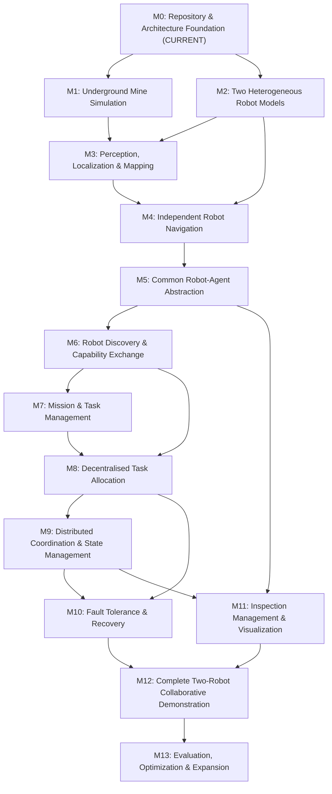

# Development Roadmap & Milestone Sequence

The Decentralized Multi-Robot Mine Inspection Platform follows a rigorous, phased engineering roadmap. Development progresses through 14 formal milestones (**M0 through M13**), transitioning from foundational architecture and simulation to decentralized autonomy, collaborative mission execution, and multi-robot fleet scaling.

---

## 1. Milestone Dependency Graph

---

## 2. Milestone Overview Table

| Milestone | Title | Focus Area | Required Modules | Primary Layer | Status |
| :--- | :--- | :--- | :--- | :--- | :--- |
| **M0** | Repository & Architecture Foundation | Repository setup, documentation, interfaces, standards | All Modules (Docs/Arch) | All Layers | **IN_PROGRESS** |
| **M1** | Underground Mine Simulation | Gazebo Sim subterranean world, procedural tunnels, hazards | MOD-1.1 | Layer 1 | PLANNED |
| **M2** | Two Heterogeneous Robot Models | Robot A (diff-drive) & Robot B (tracked) URDF/Xacro, sensors | MOD-1.2 | Layer 1 | PLANNED |
| **M3** | Perception, Localization & Mapping | LiDAR/camera processing, 3D SLAM, multi-robot map alignment | MOD-1.3 | Layer 1 | PLANNED |
| **M4** | Independent Robot Navigation | Nav2 integration, 3D costmaps, local planners, slip recovery | MOD-1.4 | Layer 1 | PLANNED |
| **M5** | Common Robot-Agent Abstraction | HAL gateway, authoritative local safety manager, lifecycle FSM | MOD-1.5, MOD-1.6 | Layer 1 | PLANNED |
| **M6** | Robot Discovery & Capability Exchange | Eclipse Zenoh peer discovery, heartbeat gossip, capability JSON | MOD-2.1, MOD-2.2 | Layer 2 | PLANNED |
| **M7** | Mission & Task Management | Mission DAG parsing, cycle detection, task decomposition | MOD-2.3, MOD-3.1 | Layer 2 & 3 | PLANNED |
| **M8** | Decentralised Task Allocation | P2P Contract Net Protocol (CNP) auctions, multi-factor cost | MOD-2.4 | Layer 2 | PLANNED |
| **M9** | Distributed Coordination & State | CRDT state replication, spatial tunnel yield deconfliction | MOD-2.5, MOD-2.6 | Layer 2 | PLANNED |
| **M10** | Fault Tolerance & Recovery | Heartbeat watchdogs, task lease revocation, reassignment | MOD-2.7, MOD-2.8 | Layer 2 | PLANNED |
| **M11** | Inspection Management & UI | Fleet telemetry dashboard, thermal anomaly logs, MinIO evidence | MOD-3.2, 3.3, 3.4 | Layer 3 | PLANNED |
| **M12** | Two-Robot Collaborative Demo | End-to-end mission: Robot A maps, Robot B inspects thermal fault | All Modules (Integrated) | All Layers | PLANNED |
| **M13** | Evaluation, Optimization & Scale | Communication degradation stress tests, 3+ robot expansion SDK | MOD-3.5, Test Benches | All Layers | PLANNED |

---

## 3. Engineering Execution Principles

1. **Strict Upstream Readiness**: No milestone implementation may commence until all upstream prerequisite milestones have achieved formal acceptance.
2. **Layer Isolation Enforcement**: Code developed in higher milestones (e.g., M8 Task Allocation) must interact with lower layers exclusively through the contracts defined in [SHARED_INTERFACE_DEFINITIONS.md](../06_interfaces_and_protocols/SHARED_INTERFACE_DEFINITIONS.md).
3. **Safety Autarchy Preservation**: No milestone may weaken the independent 50 Hz execution authority of the Layer 1 `local_safety_manager` established in M5.
4. **Verified Performance Benchmark Requirement**: All numerical throughput, latency, and convergence targets remain labeled `[PROPOSED TARGET]` until validated through reproducible CI simulation runs.
